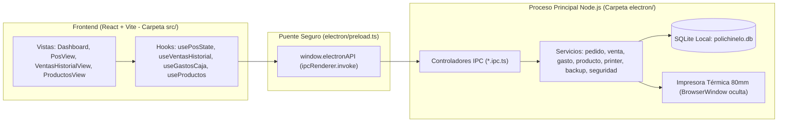

# 🛠️ Manual Técnico Avanzado y de Arquitectura — Polichinelo POS

Guía de ingeniería, mantenimiento, base de datos y despliegue para que puedas **administrar, modificar, depurar y lanzar versiones de Polichinelo POS por tu cuenta** en cualquier momento sin depender de Gemini ni de ningún asistente externo.

---

## 1. Arquitectura General del Sistema

Polichinelo POS es una aplicación de escritorio nativa para Windows construida con **Electron + React + TypeScript + Tailwind CSS + Prisma ORM (SQLite / LibSQL)**.



### Regla de Oro de Comunicación (IPC)
El frontend (`src/`) **nunca** accede directo al disco duro ni a SQLite. Todo pasa por `window.electronAPI`:
1. El servicio se programa en `electron/modules/<modulo>/<modulo>.service.ts`.
2. Se registra el canal en `electron/modules/<modulo>/<modulo>.ipc.ts` con `ipcMain.handle('nombre-canal', ...)`.
3. Se expone en `electron/preload.ts` y se tipa en `src/types/electron.d.ts`.

---

## 2. Mapa Detallado de Archivos del Proyecto

### A. Backend / Electron (`electron/`)
* **`electron/main.ts`**:
  * Controla el arranque de la app, el bloqueo de única instancia (`app.requestSingleInstanceLock()`), el protocolo `pos-media://` para cargar fotos locales de productos, el auto-updater de GitHub (`electron-updater`) y el backup automático al cerrar la ventana (`window.on('close')`).
* **`electron/preload.ts`**:
  * Expone todas las funciones del backend al frontend bajo `window.electronAPI`.
* **`electron/config/database.ts`**:
  * Conecta Prisma con el archivo SQLite (`polichinelo.db`).
  * Contiene `ensureDatabaseReady()`, que ejecuta `CREATE TABLE IF NOT EXISTS` y `CREATE INDEX IF NOT EXISTS` al arrancar, garantizando que cualquier computador nuevo o existente tenga todas las tablas e índices creados sin requerir migraciones manuales.
* **`electron/config/seedMenu.ts`**:
  * Si la base de datos está vacía en una instalación limpia, siembra automáticamente las categorías, productos e ingredientes iniciales de Polichinelo.
* **`electron/modules/printer/printer.service.ts`**:
  * Genera el HTML/CSS térmico de **80mm** (`width: 70mm`, `margin: 0`, `.feed-bottom { height: 16mm }`) y lo envía silenciosamente a la impresora térmica usando una ventana oculta (`webContents.print({ silent: true })`).
* **`electron/modules/pedido/pedido.service.ts`**:
  * Crea el pedido dentro de una transacción (`prisma.$transaction`), hace `upsert` del cliente por teléfono, guarda una foto JSON de los datos de domicilio en `detallesDestino` y dispara el backup automático en segundo plano.
* **`electron/modules/venta/venta.service.ts`**:
  * Consulta ventas paginadas, calcula métricas de arqueo mediante consultas `groupBy` optimizadas en SQLite, cambia métodos de pago, anula/restaura pedidos y genera el reporte `.csv` para Excel.
* **`electron/modules/gasto/gasto.service.ts`**:
  * Registra salidas con la hora real de Colombia y distingue salidas en **Efectivo de Caja** vs. **Transferencia** (usando el prefijo interno `[TRANSFERENCIA] ` en `descripcion` para mantener compatibilidad total sin alterar columnas de SQLite).
* **`electron/modules/backup/backup.service.ts`**:
  * Crea copias seguras de SQLite usando `VACUUM INTO` hacia una carpeta temporal y copiando el `.db` a las subcarpetas `FinDeSemana_YYYY-MM-DD_al_YYYY-MM-DD`. Mantiene las últimas 8 semanas (`MAX_SEMANAS_GUARDADAS = 8`).
* **`electron/modules/seguridad/seguridad.service.ts`**:
  * Guarda y verifica el PIN de supervisor encriptado con SHA-256 en `%APPDATA%\polichinelo-pos-app\seguridad-pin.json` (PIN por defecto: `1234`).

---

## 3. Esquema de Base de Datos SQLite (`prisma/schema.prisma`)

La base de datos consta de **9 tablas**:
1. **`Categoria`**: `id`, `nombre`, `creadoEn`.
2. **`Producto`**: `id`, `categoriaId`, `nombre`, `precioVenta`, `costoBase`, `imagenUrl`, `esEspecial`, `activo`.
3. **`Ingrediente`**: `id`, `nombre` (único).
4. **`ProductoIngrediente`**: Tabla puente (`productoId`, `ingredienteId`).
5. **`Cliente`**: `id`, `telefono` (único), `nombre`, `direccion`, `referenciaDireccion`.
6. **`Pedido`**: `id` (consecutivo de orden), `clienteId`, `tipoPedido` (`MESA`, `LLEVAR`, `DOMICILIO`), `detallesDestino` (nombre del cliente o JSON con snapshot de domicilio), `montoDomicilio`, `estado` (`REALIZADO` o `ANULADO`), `total`, `motivoAnulacion`, `observacionesGenerales`, `fechaRegistro`.
7. **`PedidoDetalle`**: `id`, `pedidoId`, `productoId`, `cantidad`, `precioUnitario`, `observaciones`, `subtotal`.
8. **`Banco`**: `id` (slug/uuid), `nombre` (`Nequi`, `Bancolombia`, etc.), `activo`.
9. **`PagoDetalle`**: `id`, `pedidoId`, `metodoPago` (`Efectivo`, `Transferencia`), `monto`, `bancoId`.
10. **`Gasto`**: `id`, `descripcion`, `monto`, `fechaRegistro`.
11. **`MetodoPago`**: `id`, `nombre`, `codigo`, `requiereBanco`, `activo`, `orden`.

### Cómo agregar una columna o tabla nueva en el futuro
Si algún día quieres agregar un campo nuevo a la base de datos:
1. Agrégalo en `prisma/schema.prisma`.
2. En `electron/config/database.ts` (dentro de `ensureDatabaseReady`), agrega una sentencia segura para que los computadores que ya tienen la app instalada creen la columna sin perder datos:
   ```ts
   try {
     await rawClient.execute(`ALTER TABLE "Pedido" ADD COLUMN "nuevaColumna" TEXT`)
   } catch {
     // Ya existe la columna, ignorar
   }
   ```
3. Corre en terminal:
   ```powershell
   npx prisma generate
   ```

---

## 4. Cómo Modificar la Impresora Térmica (80mm)

Todo el diseño del ticket físico impreso está en **`electron/modules/printer/printer.service.ts`**:
* **Ancho útil del papel:** Aunque el rollo mide `80mm`, el cabezal térmico imprime sobre `72mm`. Por eso el `body` tiene `width: 70mm; margin: 0; padding: 1mm 2mm;`. **Nunca pongas `margin: 0 auto`**, porque el driver térmico desplaza todo a la derecha.
* **Espacio de corte inferior (`.feed-bottom`):** Al final del HTML hay un `<div class="feed-bottom"></div>` con `height: 16mm;`. Si algún día cambian de marca de impresora y la cuchilla corta muy cerca o muy lejos del texto final, solo debes subir o bajar ese `16mm` (por ejemplo a `12mm` o `20mm`).
* **Detección de impresora:** El servicio busca automáticamente una impresora cuyo nombre contenga `pos`, `receipt`, `thermal`, `termica`, `80`, `58`, `tm-t`, `bixolon`, `xprinter` o `star`. Si no encuentra ninguna con esos nombres, usa la **impresora predeterminada de Windows**.

---

## 5. Cómo Funciona la Jornada Nocturna (Corte 04:00 a. m.)

Para evitar que los pedidos tomados después de la medianoche (entre `12:00 a. m.` y `03:59 a. m.`) se pasen al día siguiente o que el backup del domingo por la madrugada no se ejecute:
* **`getRangoUTC5(fechaInicio, fechaFin)`** en `venta.service.ts` y `gasto.service.ts`:
  * Una fecha `YYYY-MM-DD` consulta desde las **`04:00:00-05:00`** de ese día hasta las **`03:59:59.999-05:00`** del día siguiente (`+28 horas` desde las `00:00` del día final).
* **`obtenerInfoTurnoColombia()`** en `backup.service.ts` y **`obtenerFechaJornadaActual()`** en `useVentasHistorial.ts`:
  * Restan 4 horas a la hora actual (`Date.now() - 4 * 3600 * 1000`) para saber qué fecha operativa está en curso.
* *¿Quieres cambiar la hora de corte en el futuro (ej. a las 3:00 a. m. o a las 00:00)?* Solo busca `4 * 60 * 60 * 1000` y `T04:00:00-05:00` en esos 3 archivos (`venta.service.ts`, `gasto.service.ts`, `backup.service.ts` y `useVentasHistorial.ts`).

---

## 6. Ubicación de Archivos en el PC de la Tienda (`%APPDATA%`)

Presionando **`Windows + R`** y escribiendo `%APPDATA%\polichinelo-pos-app` accedes a todos los datos locales de producción:

| Archivo / Carpeta | Descripción y Uso de Emergencia |
| :--- | :--- |
| **`polichinelo.db`** | **Base de datos SQLite principal.** Contiene todos los clientes, productos, pedidos y gastos. Para abrirla y verla por dentro puedes usar el programa gratuito *DB Browser for SQLite*. |
| **`uploads/productos/`** | Carpeta donde se guardan las fotos de los productos subidos. |
| **`seguridad-pin.json`** | Contiene el hash SHA-256 del PIN de supervisor. **Si lo borras con la app cerrada, el PIN vuelve a ser `1234`.** |
| **`backup-config.json`** | Guarda la ruta de la carpeta de Backups / Google Drive y la fecha del último respaldo. |
| **`Backups_Polichinelo/`** | Carpeta por defecto de respaldos si no se ha elegido una carpeta de Google Drive. |

---

## 7. Guía Paso a Paso para Compilar y Publicar una Nueva Versión (Release)

Cuando hagas cualquier cambio en el código y quieras enviarlo al computador de la tienda mediante el botón **Actualizaciones**:

### Paso 1: Verificar que no haya errores de TypeScript
```powershell
npx tsc --noEmit
```

### Paso 2: Subir el número de versión en `package.json`
Abre `package.json` y aumenta `"version"` (ej. de `"1.0.4"` a `"1.0.5"`).

### Paso 3: Cerrar la app y generar el instalador
```powershell
Stop-Process -Name "Polichinelo POS" -Force -ErrorAction SilentlyContinue
pnpm run build
```
Esto generará la carpeta `release/1.0.5/`.

### Paso 4: Subir el código y el Tag a GitHub
```powershell
git add -A
git commit -m "release: v1.0.5 - descripcion del cambio"
git tag v1.0.5
git push origin main --tags
```

### Paso 5: Crear el Release en la web de GitHub
1. Entra a `https://github.com/SYepesCommit/polichinelo-pos-app/releases` -> **Draft a new release**.
2. Elige el tag **`v1.0.5`**.
3. Arrastra desde la carpeta `release/1.0.5/` estos **3 archivos**:
   * `Polichinelo-POS-Windows-1.0.5-Setup.exe`
   * `Polichinelo-POS-Windows-1.0.5-Setup.exe.blockmap`
   * `latest.yml` *(Indispensable: contiene el hash SHA-512 y la versión que lee el auto-updater).*
4. Haz clic en **Publish release**.
5. En la tienda, solo tocan el botón **Actualizaciones** en el Dashboard -> **Instalar**.
